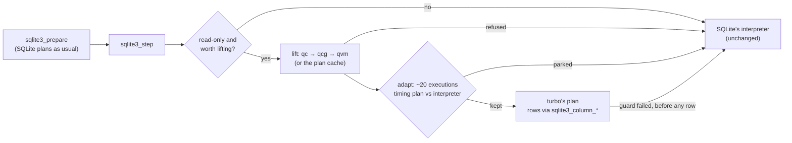

# cursed-sqlite-turbo

Turbo makes SQLite's complex read queries faster without changing SQL, the planner, or the file format. It takes
the bytecode SQLite has already compiled for a statement and, when it can produce exactly the same rows more
cheaply, runs its own executor instead. Otherwise it hands the statement back to SQLite's interpreter, unchanged.

It is a patch to the SQLite amalgamation plus three C files, used through SQLite's normal C API. It is not a fork of
SQLite, a new database or a JIT: no machine code is generated. (The project was called cursed-sqlite-jit before it
had a clearer idea of what it was.)

> **Status: experimental.** Every result is checked against stock SQLite at scale (see
> [Correctness](#correctness)), but nobody runs this in production yet. It's pinned to SQLite 3.54.1.

## What to expect

On 1,292 real statements from 44 open-source applications, measured on an x86 Xeon with sqlgauntlet, turbo's
benchmark and test harness (a separate project, to be published); see [docs/BENCHMARKS.md](docs/BENCHMARKS.md):

| | statements prepared once, run repeatedly | prepared, run and finalized every time |
|---|---:|---:|
| apps' everyday statements (wave 1, 802) | **0.953×** stock time | 0.979× |
| apps' analytics statements (wave 2, 490) | 0.999× | 1.011× |

- **Where the gains are:** the typical statement is level. The gains are concentrated in shapes where SQLite spends
  its time in its own bytecode loop:
  - recursive and plain CTEs, window functions, UNION / INTERSECT / EXCEPT: **0.71–0.82×** once turbo has settled;
  - GROUP BY and aggregates: 0.84–0.87×;
  - subqueries, multi-way joins and scans with expressions: about 0.9×.
- **Where they aren't:**
  - big scans and joins bound by B-tree reads, FTS, virtual tables and writes are level;
  - tiny point lookups prepared on every call can be up to about 4 % slower.

**Use turbo** for read-heavy applications that run the same reporting, dashboard, feed or analytics queries over and
over.

**Don't expect anything** from write-heavy workloads, or from statements that each run only a handful of times:
turbo needs about 20 executions of a statement to measure whether its version is faster, and half of those run on
SQLite's own interpreter. [BENCHMARKS.md](docs/BENCHMARKS.md#when-to-use-turbo-and-when-not-to) has the details.

## How it works



- **The tiers:**
  - **qcg:** general loop-nest plans, with batched B-tree descents and per-record-shape decoders.
  - **qvm:** an executor for any other read-only bytecode, with type feedback and specialised loop regions.
- **adapt:** times a new plan against SQLite's interpreter on the same statement, and keeps it only if it's faster.
  Losers are parked back to SQLite.
- **Plan cache:** plans survive finalize and re-prepare.
- **State:** everything is per connection, under the connection's own mutex.

[docs/ARCHITECTURE.md](docs/ARCHITECTURE.md) has the full flow, adapt's state machine, streaming, and how the build
patches SQLite.

## Quickstart

### Build from a clean clone

Needs a C compiler, Python 3, `curl` and `unzip`.

```sh
git clone https://github.com/public/cursed-sqlite-turbo.git
cd cursed-sqlite-turbo
make          # fetches SQLite 3.54.1 (pinned, SHA-256 checked), patches it into build/gen/sqlite3.c, generates decoders
make test     # builds a test database and checks turbo's results against SQLite's, value by value
```

Tested on macOS arm64 (clang), Linux x86-64 (clang 18/19, gcc 13) and Linux arm64 (gcc 13).

### Use it from C, unchanged code

Compile your program against `build/gen/sqlite3.c` with `qc/qc.c` included after it, and turn serving on. Nothing
else changes: `sqlite3_prepare_v2`, `sqlite3_step`, `sqlite3_column_*`, `sqlite3_reset` and `sqlite3_finalize` work
as always.

```c
/* app.c */
#include "sqlite3.c"   /* build/gen/sqlite3.c: the amalgamation with turbo's hooks */
#include "qc.c"        /* qc/qc.c: pulls in qcg.c and qvm.c */

int main(void) {
  sqlite3_qc_serve(1);   /* or run with QC_SERVE=1, or build with -DQC_SERVE_DEFAULT=1 */
  sqlite3 *db; sqlite3_open("app.db", &db);
  /* ... your code, as before ... */
  sqlite3_close(db);
}
```

```sh
cc -O2 -Ibuild/gen -Iqc -w app.c -o app -lm -lpthread   # -w as the Makefile: qc's code is warning-noisy
```

**Notes:**
- **Threads:** add `-DSQLITE_THREADSAFE=1` (or 2) if your program uses threads. Turbo is safe in both modes.
- **Off switch:** `QC_SERVE=0` in the environment turns turbo off without a rebuild.
- **Counters:** `QC_STATS=1` prints at exit what was served, parked and refused, and why.

### Use it from Python

`bindings/python` builds `turbo_sqlite3`. That's CPython's own `sqlite3` module, compiled against turbo's SQLite,
so it has the standard library's API release for release (Python 3.10–3.15, not free-threaded; macOS or Linux).

```sh
pip install ./bindings/python
```

```python
import turbo_sqlite3 as sqlite3        # or turbo_sqlite3.install() before anything imports sqlite3 (Django)
```

For SQLAlchemy, use `create_engine("sqlite:///app.db", module=turbo_sqlite3)`. CPython's `test_sqlite3` passes with
turbo on and off. [bindings/python/README.md](bindings/python/README.md) has the details and an end-to-end benchmark.

### Other bindings

| binding | status |
|---|---|
| **Python** (`turbo_sqlite3`) | on `main`, in [bindings/python](bindings/python). Not on PyPI. |
| **Node** (`better-sqlite3-turbo`, better-sqlite3 13.0.3 on turbo's SQLite) | **not on `main` and not pushed**: on the local branch `claude/node-binding-fc5bb0`. Its tests pass on macOS. Not on npm. |
| **WebAssembly** (Emscripten, SQLite's JS API with `stmt.qc()`) | opt-in, in [wasm/](wasm) ([docs/WASM.md](docs/WASM.md)) |

### Use qc's own API, for the most speed

The drop-in path copies each served row into the statement's result row. qc's own API skips that. Rows go to a
callback as zero-copy values pointing into the database pages, or the plan writes a JSON body directly from a
template.

```c
sqlite3_stmt *feed;
sqlite3_prepare_v3(db,
  "SELECT p.id, p.body, p.created_at, u.username,"
  "       (SELECT count(*) FROM likes l WHERE l.post_id = p.id)"
  "  FROM posts p JOIN users u ON u.id = p.user_id"
  " ORDER BY p.created_at DESC, p.id DESC LIMIT 20",
  -1, SQLITE_PREPARE_PERSISTENT, &feed, 0);
sqlite3_qc(feed);                       /* 1 = lifted; 0 = turbo doesn't take it (nothing changes) */

static const QcJson tmpl = { "{\"posts\":[", "]}", ",", 5, "isssi",
  { "{\"id\":", ",\"body\":", ",\"created_at\":", ",\"author\":", ",\"like_count\":", "}" } };
sqlite3_qc_json(feed, &tmpl);           /* optional: the plan writes the body */

QcOut o = { buf, sizeof buf };          /* keep ~64 bytes of slack at the end of buf */
if (sqlite3_qc_exec(feed, 0, &o) == SQLITE_OK) send(buf, o.n);
else { /* QC_FALLBACK: step the statement as usual */ }
```

**Details:**
- **Rows instead of JSON:** pass a callback, `sqlite3_qc_exec(stmt, cb, ctx)`. It receives the rows as `QcVal`s
  (type, integer, or pointer and length into the pages, valid during the call).
- **Parameters** can be passed as plain values in `QcOut.param` instead of `sqlite3_bind_*`.
- **Transactions:** in autocommit mode, `sqlite3_qc_exec` opens and ends its own read transaction. Inside an explicit
  transaction it runs in that one.
- **Re-prepares:** a statement re-prepared by SQLite (a schema change, a binding its plan depended on) is lifted
  again on its next execution, and keeps its template.

**On an unmodified SQLite (`-DQC_STOCK=1`):** include SQLite's own `sqlite3.c`, byte for byte, then `qc.c`, with
`-DQC_STOCK=1 -Ibuild/gen-stock` (`make stock` generates `build/gen-stock/qc_copies.c`, qc's copies of the SQLite
functions it calls, from the stock amalgamation; `-DQC_STOCK_COPIES=0` leaves them out). There are no hooks in SQLite,
so:
- qc's per-statement and per-connection state live in side tables (the connection's `sqlite3_set_clientdata`), not in
  `struct Vdbe` and `struct sqlite3`; `sqlite3_close` drops a connection's (or `sqlite3_qc_close(db)` before it).
- **Call `sqlite3_qc_forget(stmt)` before `sqlite3_finalize`**, or use `sqlite3_qc_finalize(stmt)`. A statement
  finalized without it keeps its plan until the connection closes, and a new statement at its address could be handed
  the old plan.
- Only qc's own API: `sqlite3_qc_serve` does nothing, and nothing is streamed. On `QC_FALLBACK` step the statement.
- `sqlite3_qc_exec` closes its plans' cursors before it returns. In autocommit that is what the patched build does too;
  inside an explicit transaction a plan reopens its cursors on every run.
- The plan cache compares every program's signature at a prepare (no count of expired statements to skip it by).
- `make stock` runs the test, regress, qcache, topn and corpus suites in this mode; `make stock-bench` compares it with the
  patched build on the feed and a post by id.

## Correctness

The rule is that a served statement returns exactly what SQLite's interpreter would return, or isn't served.
- **Before rows go out:** anything a plan can't reproduce exactly is detected before the first row is handed out:
  an unexpected value type, a NULL join key, an overflow record, an expired statement. The statement then runs in
  SQLite's interpreter.
- **The evidence:** differential testing at scale, plus a Lean 4 pilot. The Lean model proves that the comparison
  fast paths, the sort, the top-N sorter, LIKE and the record decoders agree with a model of SQLite's value order,
  affinity and record format. It also proves the planned sort-key prefix.
  - **The limits:** the proofs are about hand transcriptions of the C made on 2026-10-27, and fast paths added since
    aren't modelled. The model is not SQLite's C.
  - **The oracle:** `make lean-oracle` uses the model as a test oracle against SQLite and the current turbo
    ([docs/LEAN.md](docs/LEAN.md)).
  - **So:** this is evidence for those rules, not a proof of the whole system.
  - `make test`, `serve`, `regress`, `qcache`, `topn`, `corpus` and `threads` compare every value with the
    interpreter, on every change.
  - **sqllogictest:** 11.46M queries, 0 differences.
  - **SQLite's TCL suite:** 0 differences.
  - **SQLite's fuzz corpora:** under ASan and UBSan, 0 differences.
  - **SQLancer.**
  - **The application query corpus:** stock and turbo results are hashed and compared on every run.

[docs/ARCHITECTURE.md](docs/ARCHITECTURE.md#correctness-what-is-tested-and-what-isnt) says what each covers, when it
last ran, and what none of them cover.

## Known limitations

**What turbo serves:**
- **Only read-only statements.** Writes, DDL and `PRAGMA`s with side effects always run in SQLite's interpreter.
- **Not served at all:**
  - virtual tables (FTS included) and statements that open no table;
  - connections with a trace (`sqlite3_trace_v2`) or progress callback;
  - `EXPLAIN`;
  - non-UTF-8 databases.

**When it helps:**
- **About 20 executions to settle.** A statement that runs only a few times is measured, not sped up.
- **Small statements prepared on every call** can be up to about 4 % slower than stock.
- **adapt's verdicts are timing-based.** Which statements are kept or parked can differ between machines and runs.
  The results never differ.

**API differences:**
- **Counters:** a served statement's `sqlite3_stmt_status` counters (VM steps, full-scan steps, sorts) stay 0.
- **Memory:** turbo's per-connection state (plans, the plan cache, run scratch) counts in `sqlite3_memory_used`,
  and is freed when the connection closes.
  - **Pinned pages:** a qvm execution keeps the page-cache pages its text values point into pinned until it ends.
    Past `QV_PIN_CHEAP` (128) pages it copies text instead, and past `QV_MAXPINS` (65,536) it falls back.
- **Streamed results and writes:** a large result is streamed by default. If the same connection runs another
  statement while a stream is paused, turbo first reads the rest of the stream's rows. A write on that connection
  then can't change what the paused statement returns. With SQLite alone, whether it would is undefined
  ([isolation](https://sqlite.org/isolation.html)).

**Builds and platforms:**
- **Pinned to SQLite 3.54.1.** `qc/patch.py` finds each hook by an exact anchor and fails the build if SQLite's code
  around it has changed. Other versions need the anchors checked.
- **Compile options:** only the option sets in the Makefile and the bindings are tested.
- **Windows** compiles, but has not been run.
- **Python:** the binding doesn't support free-threaded builds (3.13t, 3.14t).

## Configuration

Build-time knobs (plan caps, pin limits, the top-N size, the plan cache, adapt's thresholds) and run-time switches
(`QC_SERVE`, `QC_STATS`, `QC_NOADAPT`, `QC_ADAPT_MARGIN`, `QC_STREAM`, …) are in [docs/CONFIG.md](docs/CONFIG.md).

## Repository

| | |
|---|---|
| `qc/qc.c` | the shared record decoders and batched seeks, the serving layer, adapt, the plan cache, the public API (`#include` after the patched `sqlite3.c`) |
| `qc/qcg.c` | general loop-nest plans (included by `qc.c`) |
| `qc/qvm.c` | qvm, the executor for any other read-only program (included by `qc.c`) |
| `qc/patch.py` | adds turbo's hooks to the amalgamation at build time |
| `qc/gen_decoders.py` | the unrolled per-shape record decoders (generated into `build/gen/qc_dec.h`) |
| `tests/` | the differential tests (`make test`, `serve`, `regress`, `qcache`, `topn`, `corpus`, `threads`) and the sqllogictest / TCL suite harnesses |
| `lean/`, `tests/lean_oracle.c` | a Lean 4 model of SQLite's value order and affinity, proofs that the comparison fast paths, the planned sort-key prefix and the specialisation policy agree with it, and the model as a test oracle against SQLite and turbo ([docs/LEAN.md](docs/LEAN.md)) |
| `tests/qbench.c`, `tests/stockcost.c` | the interpreter against qc's own API (`make bench`); patched against stock builds (`make stock-bench`) |
| `scripts/gauntlet.sh` | the benchmarks and the differential runs over real applications' statements (`make gauntlet`), from [sqlgauntlet](https://github.com/public/sqlgauntlet) at a pinned commit, against this tree |
| `bindings/python/` | `turbo_sqlite3` |
| `wasm/` | the opt-in WebAssembly build |
| `scripts/` | pinned fetches (SQLite, its source tree, sqllogictest) and the test database generator |
| `docs/` | [ARCHITECTURE](docs/ARCHITECTURE.md), [BENCHMARKS](docs/BENCHMARKS.md), [CONFIG](docs/CONFIG.md), [RESULTS](docs/RESULTS.md) (the development log, with every measurement behind the changes), [TOUGH_PROBLEMS](docs/TOUGH_PROBLEMS.md) (what still loses and why), [IR](docs/IR.md), [PRIOR_ART](docs/PRIOR_ART.md), [WASM](docs/WASM.md) |

## Licence

**This repository's code is MIT;** see [LICENSE](LICENSE).

**Third-party material** keeps its own licence:
- **The query corpus** now lives in [sqlgauntlet](https://github.com/public/sqlgauntlet) (`corpus/`), where each
  application's SQL keeps its licence. This repository's history up to the commit that removed `bench/corpus/`
  still holds it. sqlgauntlet fetches the two apps it doesn't commit (phoenix, n8n) from that history.
- **Fetched at build time, never committed:** SQLite (public domain) and CPython's `sqlite3` module (PSF).

[THIRD_PARTY.md](THIRD_PARTY.md) has the details.
