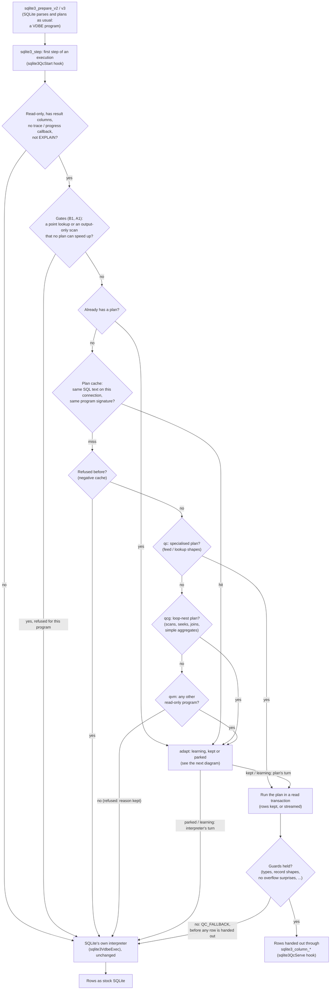
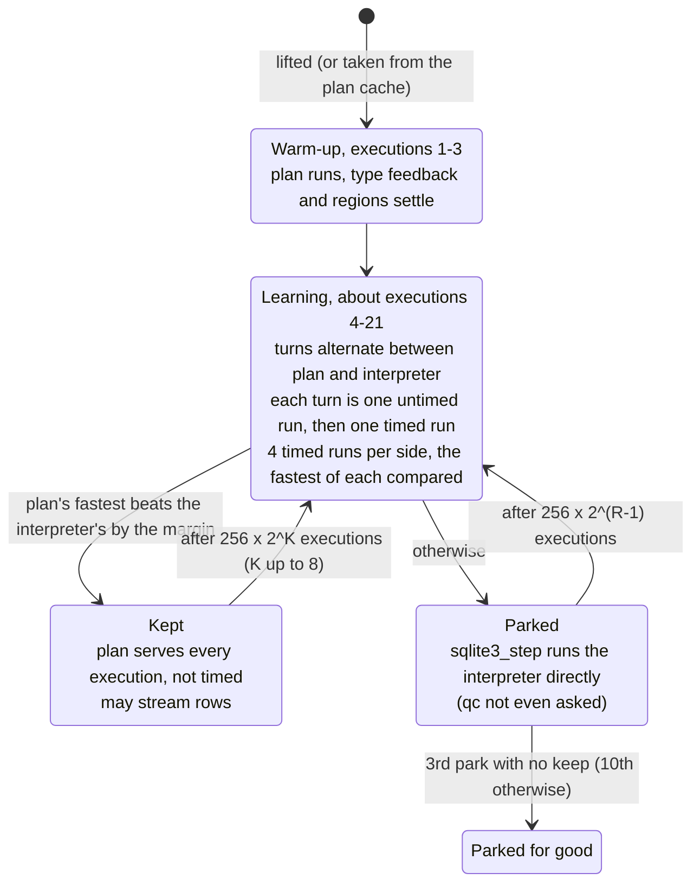
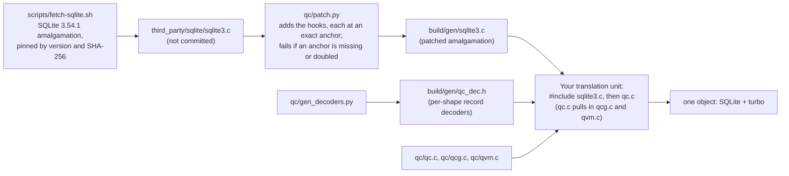

# How turbo works

Turbo doesn't change SQLite's SQL, parser, planner, or storage. It waits until SQLite has compiled a statement into
its bytecode (a VDBE program), then decides whether it can run that same program more cheaply. If it can, it runs
its own executor and hands the rows out through SQLite's normal API. If it can't, or if it later measures that its
version isn't faster, the statement runs in SQLite's own interpreter exactly as it would without turbo.

It generates no machine code. The "specialisation" is choosing pre-written executors and node kinds by looking at
the program, the schema and the values seen at run time.

## A statement's path

**The tiers, in the order they are tried:**
- **qc** (`qc/qc.c`) has hand-specialised plans for one family of shapes:
  - an index scan with a constant `LIMIT`, or a rowid lookup;
  - inner joins by rowid;
  - correlated `count(*)` subqueries, which it turns into one range walk for all rows.

  Its joins descend the B-tree for a batch of keys at once, with prefetching and interpolation search, and decode
  records with decoders generated per record shape (`qc/gen_decoders.py`).
- **qcg** (`qc/qcg.c`) builds general plans for whatever loop nest the planner emitted:
  - scans, seeks with end tests, rowid and UNIQUE points, `IN (...)` lists;
  - inner and LEFT joins, correlated `count(*)` / `EXISTS`;
  - deterministic filters, `count` / `min` / `max`, GROUP BY in index order;
  - ORDER BY through a sorter or top-N, and `LIMIT`.

  Table rows are fetched in batches behind index levels.
- **qvm** (`qc/qvm.c`) executes any other read-only VDBE program itself: coroutines, compound selects, CTEs
  (recursive ones too), window functions, DISTINCT, sorter GROUP BY, any subquery. It works on SQLite's own `Mem`
  registers, and adds:
  - **Type feedback:** the first executions record which types each `Column` and comparison actually sees.
  - **Loop regions:** a single-cursor loop body becomes a chain of direct-threaded nodes, specialised by that
    feedback, that decode each row once. A value of a type the feedback didn't predict fails a guard, and the
    region deoptimises to the generic path.
  - **Specialised structures:** hash sets for DISTINCT and `count(DISTINCT)`, vectors for ephemeral rowid tables,
    native `sum` / `avg` / `min` / `max`, and a top-N array for `ORDER BY … LIMIT N`. Past `QV_TOPN_MAX` entries
    the top-N moves into a B-tree, as SQLite would use. A sort that outgrows memory uses SQLite's own sorter.
  - **Zero-copy text:** values stay in the pinned database pages while the execution runs.

  qvm keeps its cursors and registers between executions.

**What is never served:**
- writes, DDL and other statements that aren't read-only;
- `EXPLAIN`;
- statements on a connection with a trace or progress callback;
- virtual-table scans, FTS among them (refused at lift);
- programs that open no table (a constant `SELECT`);
- statements in a non-UTF-8 database.

Each refusal is remembered for that program, so the hook costs a two-byte test from then on.

**Fallback:** a plan can fail a guard at run time, for example a value of an unexpected type, a NULL join key, an
overflow record it doesn't handle, or an expired statement. It returns `QC_FALLBACK` **before any row has been handed
out**, and SQLite's interpreter runs the statement from the start. A streamed result is the one exception (below).

## adapt: measure, then keep or park

Turbo's plans are not always faster. A plan whose work is all B-tree reads, or a statement too small for any saving
to beat the serving overhead, can be a few per cent slower. adapt measures each qcg and qvm plan against SQLite's
interpreter on the same statement, in the same process, and hands the losers back. (qc's specialised plans are not
measured; they only take shapes where they are known to win.)

- **Learning takes about 20 executions.** After the 3 warm-up executions, each sample is an untimed run and then a
  timed one, on both sides, so a verdict lands at about the 21st execution. Until then about half the executions run
  on SQLite's interpreter. A statement that runs fewer than ~20 times only ever sees the learning phase.
- **The verdict:** it compares the fastest of four timed runs on each side, since interference from the host only
  adds time.
  - **Early end:** two interpreter runs both over 1.25 times the plan's slowest end the learning early, with the
    plan kept.
  - **The margin:** `QC_ADAPT_MARGIN` (1.03 on `main`) means a plan is parked when the interpreter's fastest run is
    more than 3 % under the plan's. [BENCHMARKS.md](BENCHMARKS.md#the-adapt-margin) has the sweep behind the planned
    change to 0.98, where a plan must win by 2 % to stay.
- **What is timed is what serving costs.** That's the plan's run from its read transaction begun, plus handing out
  its rows. On the interpreter's side it's SQLite's own steps, with the transaction begun untimed on both sides.
- **The state belongs to the plan.** So it survives finalize and re-prepare through the plan cache, and a statement
  prepared on every call is not re-learned on every call.
- **`QC_NOADAPT=1`** turns adapt off: every lifted plan is served. `QC_STATS=1` prints the samples, keeps and parks
  at exit.

## Streaming

A kept qvm plan whose last run handed out at least 32 rows (with text or blob values, or 4 or more values per row)
streams. Each row goes to `sqlite3_step` as qvm reaches it, instead of the whole result being collected first.
- **One stream paused at a time per connection.** Before any other statement starts on that connection, the paused
  stream's remaining rows are collected, so a write never runs under a stream's pinned pages.
- **A failure after rows were already handed out** (a deopt, out of memory): the interpreter re-runs the statement
  from the start in the same read transaction and skips the rows already handed out. Plans that call a
  non-deterministic function don't stream, so the replay gives the same rows.
- **`QC_STREAM=0`** turns streaming off.

## The plan cache and per-connection state

**The plan cache:**
- **Detach:** when a statement is finalized, its qcg or qvm plan is kept, keyed by connection and SQL text, with its
  type feedback, regions and adapt state.
- **Reuse:** the next prepare of the same text gets it back if the new program has the same signature: every
  opcode and operand, with P4 compared by value.
- **Expiry:** a schema change, `ANALYZE`, or a new function, collation or module bumps the connection's epoch, so a
  program generated after it is compared afresh.
- **Bounds:** least recently used out (`QC_CACHE_PLANS`, default 256), and purged when the connection closes.
- **The negative cache** remembers statement texts that were refused, so they aren't lifted again on every
  prepare.

**Per-connection state:** every piece of state turbo changes at run time belongs to a connection. That covers plan
lists, run scratch, the arena and pinned pages, the plan cache, the paused stream and the adapt samples' buffers. It
hangs off three new fields of `struct sqlite3`.
- **Locking:** every hook runs under the connection's mutex, as SQLite's own code does, so turbo adds no lock of its
  own.
- **Process-wide state** is read-only after a `pthread_once` initialisation: the environment switches, constant
  tables and the clock's calibration. The `QC_STATS` counters are relaxed atomics.
- **What that means for threads:** threads with their own connections run served statements at the same time, and
  a connection shared between threads works as SQLite's serialized mode allows. `make threads` (and
  `threads-tsan`, `threads-asan`) checks this against the interpreter.

## How it is built

**What `qc/patch.py` adds to the amalgamation.** Nothing else in SQLite changes. A statement that is not served runs
exactly as before.
- **Fields:** in `struct Vdbe` and `struct sqlite3` (the plan, the rows being served, the refusal and park flags,
  the per-connection state, an epoch).
- **Two hooks in `sqlite3_step` / `sqlite3Step`:**
  - `sqlite3QcStart`, when an execution starts;
  - `sqlite3QcServe`, in place of `sqlite3VdbeExec`, which hands out the kept rows.
- **Lifecycle hooks:**
  - `sqlite3VdbeReset`: reset and finalize;
  - `sqlite3VdbeClearObject`: a program freed;
  - `sqlite3VdbeSwap`: a re-prepare;
  - `btreeEndTransaction`: plans' cursors closed at a transaction's end;
  - `sqlite3LeaveMutexAndCloseZombie`: a connection freed;
  - `sqlite3ExpirePreparedStatements`: the epoch.

`make` does all of this. The bindings run the same steps with their own compile options (`SQLITE_THREADSAFE=1`, FTS,
R*Tree and so on).

**Two ways to use it:**
- **Drop-in.** `sqlite3_qc_serve(1)`, `QC_SERVE=1` in the environment, or `-DQC_SERVE_DEFAULT=1`. Unchanged code that
  calls `sqlite3_prepare` / `sqlite3_step` / `sqlite3_column_*` gets served rows. This is what the benchmarks and both
  bindings use.
- **qc's own API.** `sqlite3_qc(stmt)` lifts a statement, and `sqlite3_qc_exec(stmt, cb, ctx)` runs it. Rows go to a
  callback as zero-copy values pointing into the database pages, or the plan writes a JSON body from a template
  (`sqlite3_qc_json`). This skips the drop-in path's row copy, and is the fastest way to run a statement turbo serves.

## Correctness: what is tested, and what isn't

Turbo's rule is that a served statement returns exactly what SQLite's interpreter would. Nothing here is a proof:
there is no formal verification of the lifters or executors. The confidence comes from differential testing,
running the same statements through turbo and through stock SQLite and comparing every value, at scale.

**Every commit** (in this repository, on any machine with a C compiler):

| target | what it compares against the interpreter |
|---|---|
| `make test` | the feed and every post id on a 50k-user / 200k-post / 800k-like database, through 300 batches of writes, DDL and schema changes from a second connection: rows and JSON bodies, value by value (about 409k comparisons) |
| `make serve` | qc serving inside `sqlite3_step`, through the plain API: resets and finalizes part way, nested statements, autocommit and explicit transactions, streamed and not, qvm only |
| `make regress` | every wrong result found so far (SQLancer, the suites, replays), each against the interpreter, with plans first and with qvm only, with `SQLITE_ENABLE_STAT4`, and with qvm's sorter handing over to SQLite's at once |
| `make qcache` | the plan cache across prepares, under schema and connection changes |
| `make topn` | qvm's top-N sorter on random `ORDER BY … LIMIT` queries, also with a 4-entry array that spills on nearly every run |
| `make corpus` | 61 common query shapes: which tier takes each, and results |
| `make THREADSAFE=1 threads` | served statements on many threads at once, with their own connections and one shared; also under TSan and ASan (`threads-tsan`, `threads-asan`, clang) |

**At milestones** (larger suites, scripts in `tests/`; results in [RESULTS.md](RESULTS.md)):
- **sqllogictest:** every query in SQLite's public corpus (`tests/build-slt.sh`, `tests/run-slt.sh`, §8).
  - **What runs:** 11.46M queries, each run four times through qc and compared with the interpreter.
  - **Latest run:** `main` at `dfc35a9` (2026-11-01, macOS arm64), with plans first and again with `QC_VM_ONLY=1`.
    Each mode made 37.8M qc runs, with 0 differences and 0 harness errors out of 11.88M tests, and no leaks.
- **SQLite's TCL test suite:** 408 query-execution test files (295k tests), with a differential `sqlite3_step`
  that also runs every read-only statement through qc (`tests/build-tcl.sh`, `tests/run-tcl.sh`, §9).
  - **Latest run:** `dfc35a9`, 2026-11-01, Linux arm64 in Docker. 85.9k statements were compiled and compared, with
    0 differences.
  - **Fewer statements than before:** the 2026-10-26 run compiled 253k. Most likely the size and scan gates and the
    no-table rule, added since, hand those statements to SQLite without lifting them. That hasn't been checked
    statement by statement.
  - **The suite's own errors are the known ones:**
    - `like.test`'s 14: it counts LIKE calls, and the differential hook calls LIKE again.
    - `attach.test` stops at 6.2 inside Docker ("Tests do not work when run as root").
- **SQLite's fuzz corpora** (`fuzzcheck`, `test/fuzzdata1–8.db`) under ASan and UBSan: 15.7k statements compared,
  0 differences, no sanitizer reports (§10, 2026-10-26; not rerun). SQLite's TH3 suite is proprietary and has not
  been run.
- **SQLancer** (NoREC, TLP and PQS oracles, through sqlite-jdbc rebuilt on turbo).
  - **First campaign** (about 65M queries): it found two turbo bugs. Both are fixed and in `make regress`.
  - **Later campaigns** (139M queries): 0 differences and 0 crashes.
  - **Where it lives:** the harness is on the bench branch, and these ran on commits from 2026-10-27.
- **The query corpus:** real application statements (1,301 in these runs, 1,276 in the repository now), with
  stock and turbo results hashed and compared on every benchmark run. The latest runs differ only where the
  statement itself is non-deterministic (see BENCHMARKS.md).
- **CPython's `test_sqlite3`** passes through the Python binding with turbo on and off.

**What this doesn't cover:**
- **Statements unlike any tested ones.** A shape no suite, fuzzer or application statement exercises could still
  hit a lifter bug. The run-time guards make the common failure a fallback, not a wrong row, but they only check
  what they were written to check.
- **Older runs:** the fuzz corpora (2026-10-26) and SQLancer (2026-10-27) haven't been rerun on `main`. About 160
  of its 194 commits came after them.
- **Platforms:** macOS arm64, Linux x86-64 (clang 18/19, gcc 13) and Linux arm64 (gcc 13). For Windows, qc compiles
  and links with mingw-w64 GCC and compiles with clang for x86-64, but nothing has been run there.
- **Compile options:** only the option sets in the Makefile and the bindings have been tested.
  `SQLITE_OMIT_*` options beyond those may break the patch's anchors (a build-time failure) or turbo's assumptions.
